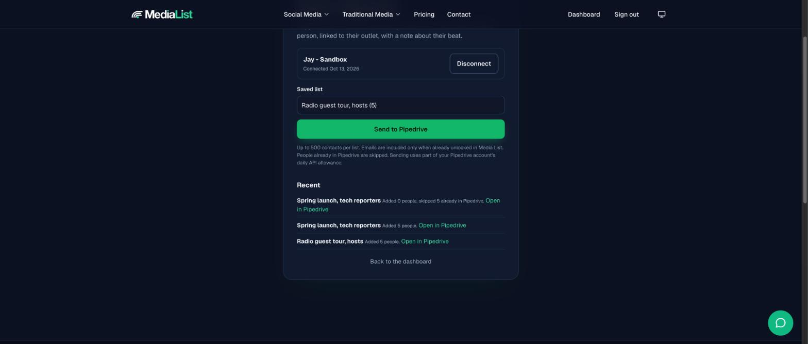
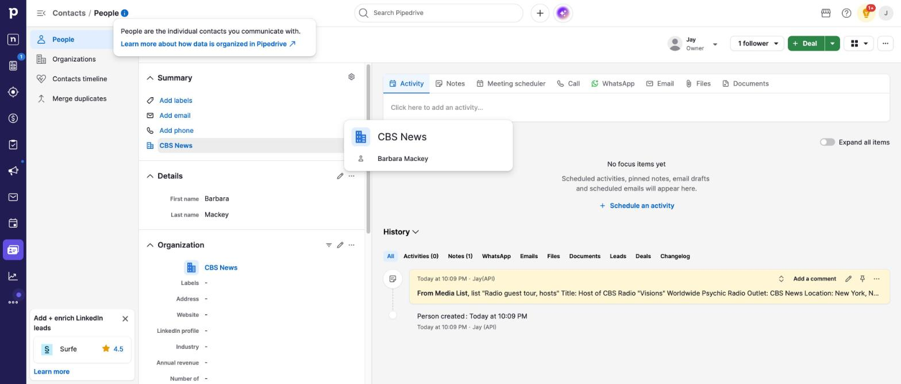

# Media List for Pipedrive

Send a saved Media List list of journalists, editors, podcast hosts and creators into Pipedrive, one person per contact.

[Media List](https://medialist.com) helps agencies, publicists and founders find the right people to pitch.

## What you need

- A Media List account with an active plan or free trial ([medialist.com/pricing](https://medialist.com/pricing))
- A Pipedrive account

## Set up

1. Sign in at [medialist.com](https://medialist.com) and save a list of contacts from the dashboard.
2. Go to [medialist.com/pipedrive](https://medialist.com/pipedrive) and click **Connect Pipedrive**.
3. On Pipedrive's screen, click **Allow and Install**.

## Send a list

1. On [medialist.com/pipedrive](https://medialist.com/pipedrive), pick a saved list.
2. Click **Send to Pipedrive**. The page updates by itself.
3. Click **Open in Pipedrive** to see the new people.

## What each person contains

| Pipedrive field | Value |
|---|---|
| Name | Contact name |
| Organization | The contact's outlet (an existing organization with the same name is reused) |
| Email | Included only when unlocked in Media List |
| Note | Title, outlet, location, type, topics, outlet website and Media List ID |

## Good to know

- Up to 500 contacts per send.
- Sending a list again adds only new people. People already in Pipedrive (same email, or same name at the same outlet) are skipped.
- Each send uses part of your Pipedrive account's daily API allowance.
- Media List asks Pipedrive only for access to contacts (people, organizations and their notes).

## Disconnect

Click **Disconnect** on [medialist.com/pipedrive](https://medialist.com/pipedrive). Media List deletes its stored access and asks Pipedrive to revoke it. You can also uninstall the app in Pipedrive under Tools and apps, Marketplace apps.

## Support

Email [support@medialist.com](mailto:support@medialist.com).

[Privacy policy](https://medialist.com/privacy) and [Terms of service](https://medialist.com/terms)
